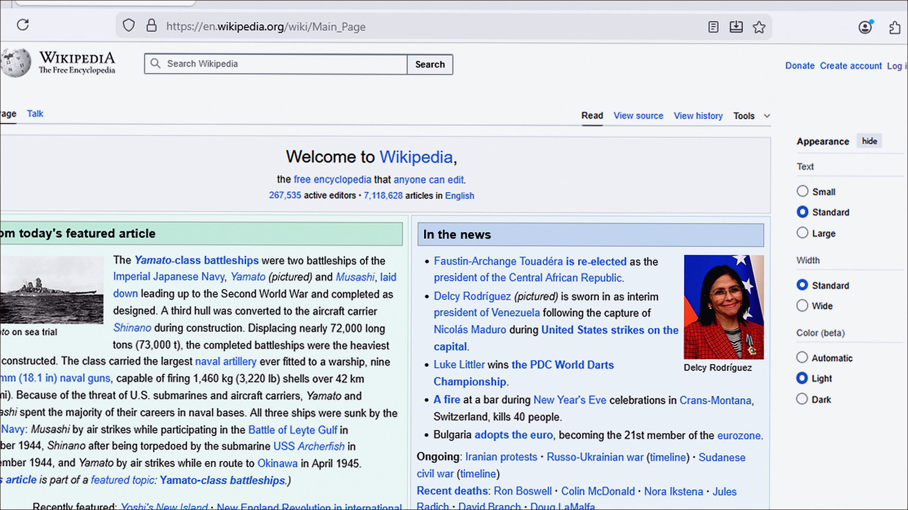
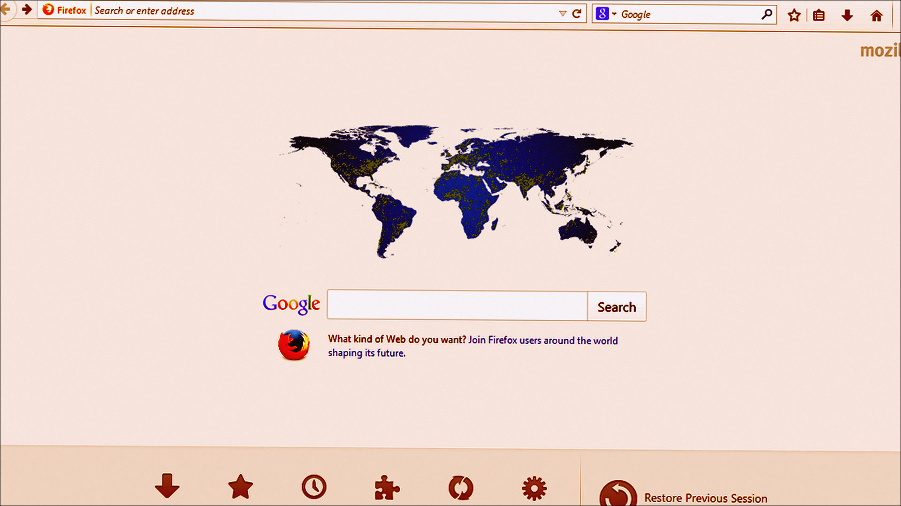
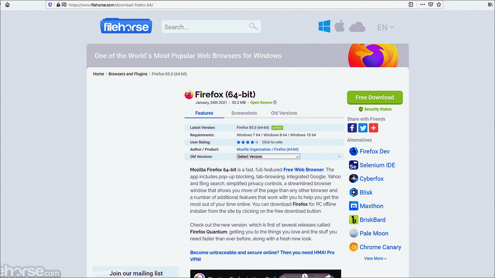

# Windows notes: Firefox

**Mozilla** · 158.0 · 91 MB · Utilities catalog

[Open card](https://moggydayprogram.com/programs/firefox) · [English](https://moggydayprogram.com/en/programs/firefox) · [GitHub Pages](https://laserbetweenmap.github.io/firefox-windows/?lang=en)

  
  
  

Браузер Mozilla. Свободный, без слежки «по умолчанию».

Firefox on Windows 10/11 x64. 91 MB. Requirements, screenshots, MoggyDay Launcher.

Get it from the catalog card, not from this repository.

| Field | Value |
| --- | --- |
| Build | 158.0 x64 |
| OS | Windows 10/11 x64 |
| Pages | https://laserbetweenmap.github.io/firefox-windows/ |

- [Opera](https://moggydayprogram.com/programs/opera)
